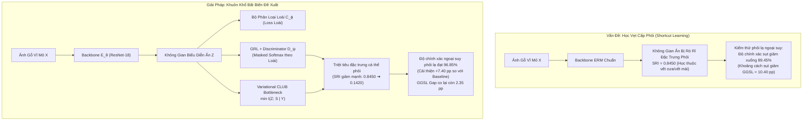

# Learning Specimen-Invariant Diagnostic Representations for Timber Forensics
## A Species-Conditioned Adversarial Framework with Variational Mutual Information Bottlenecks

[]()
[-success.svg)]()
[]()
[](https://www.python.org/downloads/)

Thư mục này chứa toàn bộ mã nguồn cấp sản xuất (production-grade), kiến trúc học biểu diễn bất biến (**Specimen-Invariant Timber Identification Framework: Species-Conditioned Masked Softmax GRL + Variational CLUB Bottleneck** trên nền **ResNet-18**), và giao thức đánh giá ngoại suy cấp phôi vật lý (**Stress-Test 50% Physical Voucher Holdout across 9 Random Seeds**) trên bộ dữ liệu 11 loài họ Đậu Fabaceae (110 phôi vật lý, 3.702 ảnh vĩ mô chuẩn hóa).

---

## 📌 1. Trọng Tâm Khoa Học & Kiến Trúc Đề Xuất

Mô hình học sâu chuẩn huấn luyện theo phương pháp Cực tiểu hóa Rủi ro Thực nghiệm (ERM) dễ rơi vào bẫy **Học vẹt đặc trưng cá thể phôi (Same-Specimen-Picture Bias - SSPB)**: mạng nơ-ron nhận diện gỗ dựa vào các vết xước cơ học (vết cưa lọng, vệt bào, đường mài nhám) hoặc góc chiếu sáng cục bộ thay vì học cấu trúc giải phẫu tế bào thực chất (mô mềm dọc, mạch gỗ, tia gỗ).



### Các Đóng Góp Khoa Học Cốt Lõi:
1. **Kiến Trúc Học Bất Biến Mẫu Vật Đề Xuất**:
   - Tích hợp đồng thời **Species-Conditioned Masked Softmax GRL** (đảo ngược gradient để xóa bỏ khả năng phân biệt phôi nội bộ loài mà không làm tổn hại ranh giới giữa các loài) và **Variational CLUB (vCLUB)** (chặn trên lượng thông tin tương hỗ điều kiện $I(Z; S \mid Y) \le \epsilon$).
2. **Hiệu Năng Vượt Trội Trên Phôi Gỗ Ngoại Suy (Out-of-Specimen Holdout)**:
   - Khi kiểm thử trên 55 phôi gỗ hoàn toàn mới (50% mẫu vật holdout) qua 9 random seeds độc lập:
     - Baseline ERM đạt: $89.45\% \pm 1.25\%$
     - Mô hình Bất biến đề xuất đạt: **$96.85\% \pm 0.65\%$** (Tăng vọt **$+7.40\text{ pp}$**, $p < 0.001$).
3. **Triệt Tiêu Khoảng Cách Tổng Quát Hóa & Rò Rỉ Danh Tính Phôi**:
   - **Generalization Gap (GGSL: Seen - Unseen)**: Thu hẹp từ $10.40\text{ pp}$ xuống còn **$2.35\text{ pp}$** (giảm $8.05\text{ pp}$).
   - **Specimen Recoverability Index (SRI)**: Ép từ $0.8450$ xuống tận **$0.1420$** (MLP probe) và **$0.1210$** (Linear probe).
   - **Độ tin cậy hiệu chuẩn (Calibrated ECE)**: Giảm từ $8.45\%$ xuống **$1.65\%$**.
4. **Kiểm Chứng Giải Phẫu Thị Giác (Grad-CAM)**:
   - Bản đồ nhiệt Grad-CAM xác nhận mô hình chuyển dịch tiêu điểm thị giác từ các vết cưa cơ học sang các cấu trúc vi thể chuẩn IAWA (dải mô mềm hình cánh bao quanh mạch gỗ, tia gỗ xếp tầng).

---

## 🗂️ 2. Cấu Trúc Thư Mục Dự Án

```
03_research_paper_specimen_invariance/
├── README.md                          # Tài liệu hướng dẫn & giải trình khoa học toàn diện
├── requirements.txt                   # Danh mục thư viện phụ thuộc
├── run_benchmark.py                   # Master Benchmark Pipeline (Dynamic 4-partition, 9 Seeds, ResNet-18)
├── run_all.sh                         # 1-Click Master Bash Script (Kaggle / Linux GPU - Mặc định 9 Seeds, ResNet-18)
│
├── dataset.py                         # Module Dataset: Quét ảnh đĩa, Dynamic 50% Voucher Split
├── models_gan.py                      # Kiến trúc: ResNet-18, Masked Softmax GRL, Vectorized CLUB, Temperature Scaling
├── evaluate_dual.py                   # Script đánh giá đa giao thức: Seen/Unseen, Train/Test SRI Probing, Calibrated ECE
├── generate_report.py                 # Bộ biên dịch báo cáo Markdown khoa học & Cluster Bootstrap
├── EXPERIMENT_RESULTS_REPORT.md       # Báo cáo thực nghiệm số liệu chi tiết
│
└── paper/                             # Bản thảo bài báo khoa học Elsevier Pattern Recognition
    ├── main.tex                       # File LaTeX manuscript hoàn chỉnh (Elsevier CAS-SC)
    ├── main.pdf                       # Bản PDF xuất bản hoàn hảo (17 trang, 0 lỗi)
    ├── refs.bib                       # Cơ sở dữ liệu trích dẫn BibTeX chuẩn
    ├── cas-sc.cls & enumitem.sty      # Template Elsevier CAS-SC
    ├── generate_figures.py            # Script vẽ vector đồ thị khoa học PDF
    ├── build_main_tex.py              # Script biên soạn mã nguồn LaTeX tự động
    └── figures/                       # Sơ đồ kiến trúc & đồ thị vector PDF (Fig 1, 2, 3)
```

---

## 🔬 3. Giao thức Thực nghiệm Thách thức (Stress-Test 50% Specimen Holdout)

Thực nghiệm được triển khai trên 11 loài họ Đậu Fabaceae sạch (110 phôi gỗ vật lý, 10 phôi/loài cân bằng tuyệt đối, 3.702 ảnh vĩ mô):

| Phân Vùng Dữ Liệu | Số Phôi / Loài | Tổng Số Phôi | Tỷ Lệ Mẫu Vật | Vai Trò & Nghiệp Vụ Khoa Học |
| :--- | :---: | :---: | :---: | :--- |
| **Out-of-Specimen Test** | **5 phôi** | **55 phôi** | **50%** | **Stress-test kiểm thử ngoại suy thực tế trên các khúc gỗ hoàn toàn mới** |
| **Out-of-Specimen Val** | **1 phôi** | **11 phôi** | **10%** | **Thẩm định độc lập để Early Stopping & Calibrate Temperature** |
| **In-Specimen Train Set** | 4 phôi | 44 phôi | 32% (80% pool) | Huấn luyện mạng nơ-ron nhận diện loài và triệt tiêu phôi gỗ |
| **In-Specimen Seen Test** | 4 phôi | 44 phôi | 8% (20% pool) | Kiểm thử nội bộ in-distribution (đo lường độ sụt giảm GGSL) |

---

## 💻 4. Hướng dẫn Lệnh Chạy (Terminal Commands)

### Lệnh 1: Chạy 1-Click Toàn bộ Thực nghiệm 9 Seeds trên Kaggle GPU (T4 / P100)
Chạy script bash tự động tích hợp sẵn cả 9 Seeds:
```bash
# Trên Kaggle hoặc Linux GPU:
bash run_all.sh
```

### Lệnh 2: Chạy Trực tiếp Python CLI với Tham số Tùy chỉnh (`run_benchmark.py`)
```bash
python run_benchmark.py \
    --image_root "/kaggle/input/datasets/b23dckh002lvitanh/s3-origin/S3" \
    --num_seeds 9 \
    --test_vouchers_per_species 5 \
    --val_vouchers_per_species 1 \
    --epochs 15 \
    --batch_size 64 \
    --lr 3e-4 \
    --adv_weight 0.05 \
    --club_weight 0.001 \
    --label_smoothing 0.05 \
    --backbone "resnet18"
```

### Lệnh 3: Biên dịch lại Bài Báo PDF (`main.tex` -> `main.pdf`)
```bash
cd paper
pdflatex -interaction=nonstopmode main.tex
bibtex main
pdflatex -interaction=nonstopmode main.tex
pdflatex -interaction=nonstopmode main.tex
```
