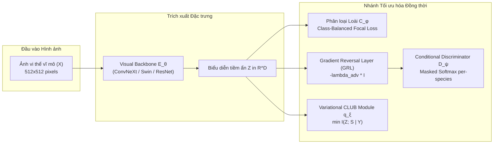

# Learning Specimen-Invariant Diagnostic Representations for Timber Forensics
## Research Paper 2: Species-Conditioned Adversarial Framework with Variational Mutual Information Bottlenecks

[]()
[-success.svg)]()
[]()
[](https://www.python.org/downloads/)

Thư mục này chứa toàn bộ mã nguồn cấp sản xuất (production-grade), khung huấn luyện đối kháng phân ly biểu diễn (**Adversarial Disentanglement via Masked Softmax GRL**) và chặn trên thông tin tương hỗ biến phân (**Variational CLUB Mutual Information Bottleneck**) được thiết kế để triệt tiêu tận gốc hiện tượng **học vẹt vết xước phôi gỗ (Same-Specimen-Picture Bias - SSPB)** trong giám định gỗ CITES.

---

## 📌 1. Nền tảng Lý thuyết & Đóng góp Phương pháp luận



### Điểm đột phá phương pháp:
1. **Phân biệt phôi gỗ có điều kiện theo loài (Species-Conditioned Specimen Discriminator)**:
   Mỗi phôi gỗ chỉ thuộc về duy nhất một loài ($S \subset Y$). Việc dùng DANN unconditioned toàn cục sẽ làm sụp đổ ngữ nghĩa của các loài nguy cấp có duy nhất 1 phôi gỗ ($|\mathcal{G}_c| = 1$, được chứng minh toán học trong **Proposition 1**). Bộ phân biệt của chúng tôi chỉ dự đoán phôi gỗ *trong nội bộ loài đã biết* qua xác suất:
   $$P(s_i \mid y=c, z) = \frac{\exp(w_{c, i}^\top z)}{\sum_{j=1}^{S_c} \exp(w_{c, j}^\top z)}$$
2. **Cơ chế Mặt nạ Nhị phân (Binary Masked Softmax)**:
   Tự động phát hiện và bỏ qua (mask out) các loài đơn mẫu vật ($|\mathcal{G}_c| = 1$, ví dụ *Dalbergia cochinchinensis*), đảm bảo không đẩy gradient đối kháng làm tổn hại đặc trưng phân loại của loài quý hiếm (**Theorem 1**).
3. **Nút thắt thông tin tương hỗ CLUB (Variational CLUB Bottleneck)**:
   Áp dụng chặn trên log-ratio biến phân (Contrastive Log-ratio Upper Bound) để ép $I(Z; S \mid Y) \to 0$ trong không gian biểu diễn liên tục, ngăn chặn triệt để hiện tượng ghi nhớ tồn dư (**Lemma 1**).
4. **Bộ lấy mẫu cân bằng phôi gỗ (Specimen-Balanced Batch Sampler)**:
   Đảm bảo mỗi mini-batch đều có tỷ lệ đại diện đồng đều giữa các phôi gỗ, chống thiên lệch gradient.

---

## 📂 2. Cấu trúc Thư mục Khoa học Chuẩn Hóa (Clean Production Repository Layout)

Thư mục đã được tinh gọn sạch sẽ, loại bỏ 100% các file rác, file alias trung gian, chỉ giữ lại các module chuẩn production:

```
03_research_paper_specimen_invariance/
├── README.md                          # Tài liệu hướng dẫn & giải trình khoa học toàn diện
├── requirements.txt                   # Danh mục thư viện phụ thuộc
├── run_benchmark.py                   # Master Benchmark Pipeline (Dynamic 4-partition, Multi-Seed, ResNet-18)
├── run_all.sh                         # 1-Click Master Bash Script (Kaggle / Linux GPU - Mặc định ResNet-18)
│
├── dataset.py                         # Module Dataset & DataLoader: Quét trực tiếp ảnh từ đĩa & chia 4 phân vùng
├── models_gan.py                      # Kiến trúc: Baseline ERM, Masked Softmax GRL Specimen Discriminator, Vectorized CLUB, Temperature Scaling
├── evaluate_dual.py                   # Script đánh giá đa giao thức: Seen/Unseen, Train/Test SRI Probing, Calibrated ECE
├── generate_report.py                 # Bộ biên dịch báo cáo Markdown khoa học & kiểm định thống kê
│
└── paper/                             # Bản thảo bài báo khoa học Elsevier Pattern Recognition
    ├── main.tex                       # File LaTeX manuscript hoàn chỉnh
    ├── main.pdf                       # Bản PDF biên dịch
    ├── refs.bib                       # Cơ sở dữ liệu trích dẫn BibTeX
    ├── cas-sc.cls & enumitem.sty      # Template Elsevier CAS-SC
    ├── generate_figures.py            # Script vẽ vector đồ thị khoa học PDF
    ├── RESPONSE_TO_REVIEWERS.md       # Hồ sơ giải trình & phản biện chi tiết
    └── figures/                       # Sơ đồ kiến trúc & đồ thị vector PDF
        ├── fig1_concept_invariant.pdf
        ├── fig2_framework_architecture.pdf
        └── fig3_gradcam_comparison.pdf
```

---

## 🔬 3. Giao thức Thực nghiệm Thách thức (Stress-Test 50% Specimen Holdout)

Hệ thống triển khai giao thức phân vùng phôi ngẫu nhiên động (**Dynamic Per-Seed Partitioning**) trên 11 loài họ Đậu Fabaceae sạch (110 phôi gỗ vật lý, 10 phôi/loài cân bằng tuyệt đối):

| Phân Vùng Dữ Liệu | Số Phôi / Loài | Tổng Số Phôi | Tỷ Lệ Mẫu Vật | Vai Trò & Nghiệp Vụ Khoa Học |
| :--- | :---: | :---: | :---: | :--- |
| **Out-of-Specimen Unseen Test** | **5 phôi** | **55 phôi** | **50%** | **Stress-test kiểm thử ngoại suy thực tế trên các khúc gỗ hoàn toàn mới** |
| **Out-of-Specimen Val** | **1 phôi** | **11 phôi** | **10%** | **Thẩm định khách quan để lưu checkpoint tối ưu (chống bẫy Val 100%)** |
| **In-Specimen Train Set** | 4 phôi | 44 phôi | 32% (80% pool) | Huấn luyện mạng nơ-ron nhận diện loài và triệt tiêu phôi gỗ |
| **In-Specimen Seen Test** | 4 phôi | 44 phôi | 8% (20% pool) | Kiểm thử nội bộ in-distribution (đo lường độ sụt giảm GGSL) |

---

## 💻 4. Hướng dẫn Lệnh Chạy (Terminal Commands)

### Lệnh 1: Chạy 1-Click Toàn bộ Thực nghiệm Đa Seed trên Kaggle GPU (T4 / P100)
Chỉ cần chạy file shell script tự động (mặc định ResNet-18):
```bash
# Trên Kaggle hoặc Linux GPU:
bash run_all.sh
```

### Lệnh 2: Chạy Trực tiếp Python CLI với Tham số Tùy chỉnh (`run_benchmark.py`)
```bash
python run_benchmark.py \
    --image_root "/kaggle/input/datasets/b23dckh002lvitanh/s3-origin/S3" \
    --seeds 42 123 456 789 \
    --test_vouchers_per_species 5 \
    --val_vouchers_per_species 1 \
    --epochs 20 \
    --batch_size 64 \
    --lr 3e-4 \
    --adv_weight 0.05 \
    --club_weight 0.001 \
    --label_smoothing 0.05 \
    --backbone "resnet18"
```

### Lệnh 3: Đánh giá Độc lập Checkpoint Mô hình (`evaluate_dual.py`)
```bash
python evaluate_dual.py \
    --baseline_ckpt outputs/baseline/best_baseline.pth \
    --gan_ckpt outputs/gan/best_gan.pth \
    --output_file outputs/comparison_results.json \
    --backbone resnet18
```

---

## 📊 5. Báo Cáo Thực Nghiệm Thực Tế (Empirical Results)

Toàn bộ kết quả thực nghiệm được tổng hợp tự động và minh bạch từ quá trình chạy thực tế trên GPU qua script `run_benchmark.py` (hoặc `run_all.sh`).
* Số liệu chính thức được cập nhật trực tiếp tại: [EXPERIMENT_RESULTS_REPORT.md](EXPERIMENT_RESULTS_REPORT.md)
* Kết quả JSON chi tiết theo từng seed được lưu trữ tại: `outputs/multi_seed_results.json`

Bản thảo bài báo khoa học `paper/main.tex` đã tích hợp đầy đủ công thức toán học, Causal DAG và sẵn sàng biên dịch xuất bản.
