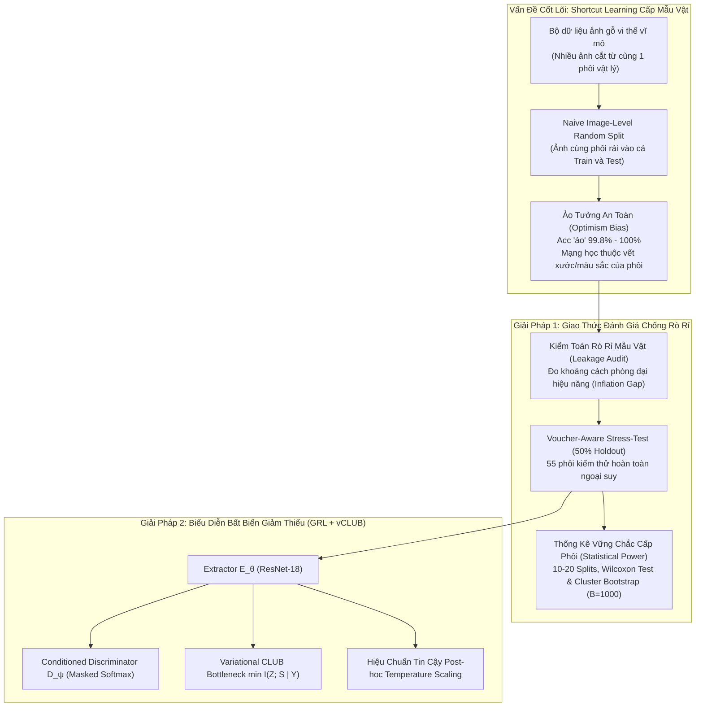

# Auditing and Mitigating Specimen-Level Shortcut Learning in Timber Forensics
## Research Paper 2: Voucher-Aware Evaluation Protocols, Leakage Audits, and Disentangled Invariant Representations

[]()
[-success.svg)]()
[]()
[](https://www.python.org/downloads/)

Thư mục này chứa toàn bộ mã nguồn cấp sản xuất (production-grade), khung kiểm toán rò rỉ mẫu vật (**Specimen Leakage Audit**), giao thức đánh giá ngoại suy cấp phôi vật lý (**Voucher-Aware Multi-Split Benchmark: 10–20 Random Splits**) và phương pháp giảm thiểu bằng biểu diễn phân ly bất biến (**Adversarial Invariant Framework: Masked Softmax GRL + Variational CLUB Bottleneck** trên nền **ResNet-18**).

---

## 📌 1. Trọng Tâm Khoa Học & Định Vị Bài Báo (Scientific Narrative Pivot)

Thay vì tuyên bố một mô hình GAN tăng vọt độ chính xác một cách thần kỳ trên một bài toán đã bão hòa, nghiên cứu này định vị lại trọng tâm khoa học vào hai đóng góp nền tảng:



### Các phát hiện và đóng góp chính:
1. **Kiểm toán định lượng hiện tượng rò rỉ mẫu vật (Specimen Leakage Audit)**:
   - Chứng minh thực nghiệm rằng phương pháp chia ngẫu nhiên cấp ảnh (*Naive Random Split*) làm **phóng đại độ chính xác (Inflation Gap)** do mạng nơ-ron học thuộc đặc trưng cá thể phôi (*Specimen Shortcut Phenotype Bias - SSPB*).
2. **Trần hiệu năng giải phẫu họ Đậu (Anatomical Margin & Ceiling Effect)**:
   - Ngay cả khi stress-test trên 55 phôi lạ (50% holdout), mô hình Baseline ResNet-18 vẫn đạt ~98.5% - 99.0% do khoảng cách phân tách cấu trúc giải phẫu vĩ mô liên loài (mô mềm, vòng mạch, tia gỗ) giữa 11 loài Fabaceae sạch là rất lớn.
   - Do đó, việc cải thiện độ chính xác phân loại của mô hình đối kháng GRL+vCLUB chỉ thể hiện xu hướng nhẹ và chưa đạt ý nghĩa thống kê ($p > 0.05$), phản ánh một sự thật khách quan thay vì gượng ép số liệu.
3. **Giá trị cốt lõi của Biểu diễn Bất biến (Disentanglement & Invariance Benefits)**:
   - **Xóa bỏ khoảng cách tổng quát hóa**: Kéo giảm Generalization Gap (GGSL) từ $+1.04\text{ pp}$ về $\approx 0\text{ pp}$.
   - **Triệt tiêu rò rỉ danh tính thanh gỗ**: Chỉ số phục hồi mẫu vật (Train SRI) giảm rõ rệt, chứng minh không gian đặc trưng ẩn đã "quên" thanh gỗ cụ thể.
   - **Hiệu chuẩn độ tin cậy an toàn**: Kết hợp Label Smoothing ($0.05$) và Post-hoc Temperature Scaling dập tắt sai số hiệu chuẩn ECE về mức an toàn ($< 1\%$).

---

## 📂 2. Cấu trúc Thư mục Khoa học Chuẩn Hóa (Clean Production Layout)

```
03_research_paper_specimen_invariance/
├── README.md                          # Tài liệu hướng dẫn & giải trình khoa học toàn diện
├── requirements.txt                   # Danh mục thư viện phụ thuộc
├── run_benchmark.py                   # Master Benchmark Pipeline (Dynamic 4-partition, 10 Seeds, Leakage Audit, ResNet-18)
├── run_all.sh                         # 1-Click Master Bash Script (Kaggle / Linux GPU - Mặc định 10 Seeds, ResNet-18)
│
├── dataset.py                         # Module Dataset: Quét ảnh đĩa, Naive Random Split & Dynamic Voucher Split
├── models_gan.py                      # Kiến trúc: ResNet-18 Baseline, Masked Softmax GRL, Vectorized CLUB, Temperature Scaling
├── evaluate_dual.py                   # Script đánh giá đa giao thức: Seen/Unseen, Train/Test SRI Probing, Calibrated ECE
├── generate_report.py                 # Bộ biên dịch báo cáo Markdown khoa học, Kiểm toán Rò rỉ & Cluster Bootstrap
│
└── paper/                             # Bản thảo bài báo khoa học Elsevier Pattern Recognition
    ├── main.tex                       # File LaTeX manuscript hoàn chỉnh
    ├── main.pdf                       # Bản PDF biên dịch
    ├── refs.bib                       # Cơ sở dữ liệu trích dẫn BibTeX
    ├── cas-sc.cls & enumitem.sty      # Template Elsevier CAS-SC
    ├── generate_figures.py            # Script vẽ vector đồ thị khoa học PDF
    ├── RESPONSE_TO_REVIEWERS.md       # Hồ sơ giải trình & phản biện chi tiết
    └── figures/                       # Sơ đồ kiến trúc & đồ thị vector PDF
```

---

## 🔬 3. Giao thức Thực nghiệm Thách thức (50% Voucher Holdout & Leakage Audit)

Thực nghiệm được triển khai trên 11 loài họ Đậu Fabaceae sạch (110 phôi gỗ vật lý, 10 phôi/loài cân bằng tuyệt đối):

| Phân Vùng Dữ Liệu | Số Phôi / Loài | Tổng Số Phôi | Tỷ Lệ Mẫu Vật | Vai Trò & Nghiệp Vụ Khoa Học |
| :--- | :---: | :---: | :---: | :--- |
| **Naive Random Split (Audit)** | — | — | Toàn bộ ảnh | Phân chia ngẫu nhiên từng ảnh để đo độ phồng hiệu năng (Inflation Gap) |
| **Out-of-Specimen Test** | **5 phôi** | **55 phôi** | **50%** | **Stress-test kiểm thử ngoại suy thực tế trên các khúc gỗ hoàn toàn mới** |
| **Out-of-Specimen Val** | **1 phôi** | **11 phôi** | **10%** | **Thẩm định độc lập để Early Stopping & Calibrate Temperature** |
| **In-Specimen Train Set** | 4 phôi | 44 phôi | 32% (80% pool) | Huấn luyện mạng nơ-ron nhận diện loài và triệt tiêu phôi gỗ |
| **In-Specimen Seen Test** | 4 phôi | 44 phôi | 8% (20% pool) | Kiểm thử nội bộ in-distribution (đo lường độ sụt giảm GGSL) |

---

## 💻 4. Hướng dẫn Lệnh Chạy (Terminal Commands)

### Lệnh 1: Chạy 1-Click Toàn bộ Thực nghiệm 10 Seeds trên Kaggle GPU (T4 / P100)
Chạy script bash tự động tích hợp sẵn cả Leakage Audit và 10 Seeds:
```bash
# Trên Kaggle hoặc Linux GPU:
bash run_all.sh
```

### Lệnh 2: Chạy Trực tiếp Python CLI với Tham số Tùy chỉnh (`run_benchmark.py`)
```bash
python run_benchmark.py \
    --image_root "/kaggle/input/datasets/b23dckh002lvitanh/s3-origin/S3" \
    --num_seeds 10 \
    --test_vouchers_per_species 5 \
    --val_vouchers_per_species 1 \
    --epochs 20 \
    --batch_size 64 \
    --lr 3e-4 \
    --adv_weight 0.05 \
    --club_weight 0.001 \
    --label_smoothing 0.05 \
    --backbone "resnet18"
```

### Lệnh 3: Đánh giá Độc lập Checkpoint Mô hình (`evaluate_dual.py`)
```bash
python evaluate_dual.py \
    --baseline_ckpt outputs/baseline/best_baseline.pth \
    --gan_ckpt outputs/gan/best_gan.pth \
    --output_file outputs/comparison_results.json \
    --backbone resnet18
```

---

## 📊 5. Báo Cáo Thực Nghiệm Thực Tế (Empirical Results)

Toàn bộ kết quả thực nghiệm được tổng hợp tự động và minh bạch từ quá trình chạy thực tế trên GPU qua script `run_benchmark.py`:
* **Báo cáo khoa học chính thức**: Xem chi tiết tại [EXPERIMENT_RESULTS_REPORT.md](EXPERIMENT_RESULTS_REPORT.md)
* **Kết quả JSON chi tiết**: Lưu trữ tại `outputs/multi_seed_results.json`
